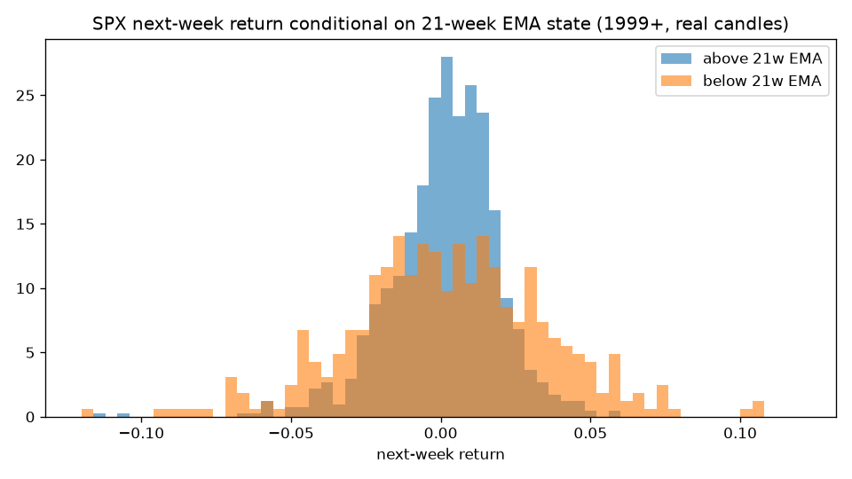
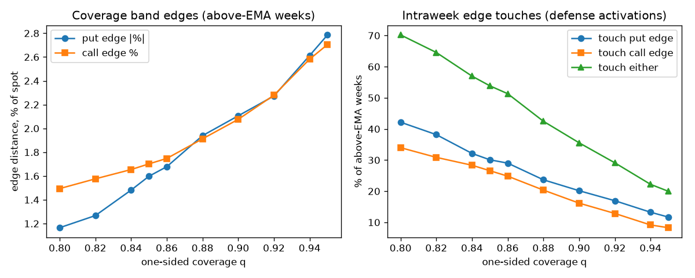

# Candle study — replication of the author's ENTIRE backtest (REAL daily candles)

**CANDLES-ONLY.** Real free daily SPX data; an explicit user-approved exception
to Pass 1's synthetic-only rule (PLAN §12.0). Per the author's 2026-08-10
disclosure, his full backtest was: "SPX% return weekly above 21 EMA to estimate
historical EV" plus static credit pricing from a ~$500 options-data slice.
This study replicates that process. **No options positions are simulated and
no claim is made about the options strategy itself.** Not investment advice.

## Data sources (all free; raw files gitignored, never committed)

- SPX daily candles (^GSPC): `yfinance ^GSPC daily, unadjusted` (7953 rows, 1995-01-03 → 2026-08-10)
- VIX daily history: `https://cdn.cboe.com/api/global/us_indices/daily_prices/VIX_History.csv` (9247 rows, 1990-01-02 → 2026-08-10)
- FRED DTB3: `https://fred.stlouisfed.org/graph/fredgraph.csv?id=DTB3` (18940 rows, 1954-01-04 → 2026-08-07)
- FRED SOFR: `https://fred.stlouisfed.org/graph/fredgraph.csv?id=SOFR` (2179 rows, 2018-04-03 → 2026-08-07)

Study window 1999-01-08 → 2026-08-07 (1440 completed weeks; EMA warm-up from 1995). State at week t's Friday close conditions week t+1's outcome (no lookahead).

## (a) Conditional next-week return distributions (21-week EMA)

| | above EMA | below EMA |
|---|---|---|
| n weeks | 1027 | 413 |
| mean | 0.1360% | 0.2050% |
| std | 1.8006% | 3.5957% |
| skew | -0.81 | -0.39 |
| % positive | 57.7% | 52.1% |
| p05 / p95 | -2.79% / 2.70% | -5.04% / 5.72% |
| p01 / p99 | -4.96% / 4.20% | -9.05% / 9.96% |
| min / max | -11.49% / 5.89% | -18.20% / 12.10% |

## (b) Implied coverage bands and strike distances (feeds §8.1 percentile family)

Edges are quantiles of the ABOVE-EMA next-week return distribution; strike
distances shown at the latest close (SPX ≈ 7,753).

| q | put edge | call edge | put dist (pts) | call dist (pts) | P(close inside) | P(touch put) | P(touch call) | P(touch any) |
|---|---|---|---|---|---|---|---|---|
| 0.80 | -1.17% | 1.49% | 90 | 116 | 59.9% | 42.2% | 34.0% | 70.2% |
| 0.82 | -1.27% | 1.58% | 98 | 122 | 64.0% | 38.2% | 30.9% | 64.6% |
| 0.84 | -1.48% | 1.65% | 115 | 128 | 67.9% | 32.1% | 28.3% | 57.0% |
| 0.85 | -1.60% | 1.70% | 124 | 132 | 70.0% | 30.1% | 26.6% | 53.8% |
| 0.86 | -1.68% | 1.75% | 130 | 136 | 72.0% | 29.0% | 24.8% | 51.3% |
| 0.88 | -1.94% | 1.91% | 150 | 148 | 75.9% | 23.7% | 20.4% | 42.5% |
| 0.90 | -2.11% | 2.08% | 163 | 161 | 79.9% | 20.2% | 16.2% | 35.5% |
| 0.92 | -2.27% | 2.28% | 176 | 177 | 83.8% | 16.9% | 12.9% | 29.1% |
| 0.94 | -2.61% | 2.58% | 203 | 200 | 87.9% | 13.2% | 9.2% | 22.2% |
| 0.95 | -2.79% | 2.70% | 216 | 210 | 89.9% | 11.7% | 8.3% | 20.0% |

Sub-period stability of the q=0.90 edges (regime dependence of the band):

| period | n | put edge | call edge |
|---|---|---|---|
| 1999-2007 | 292 | -2.14% | 1.92% |
| 2008-2016 | 333 | -2.11% | 2.17% |
| 2017-now | 402 | -1.98% | 2.19% |

## (c) Inverse solve on his claims (Kelly ~60%, win ~+30% of R, EV ~+$450/contract)

Given the empirical win probability p(q) = P(close inside band | above EMA),
binary-bet Kelly f* = p/a - (1-p)/b with win b = +30% of R fixed by his claim.
Solving f* = 0.60 for the required average loss a, then EV/R and the R per
contract implied by EV = +$450:

| q | p(win) | required avg loss (%R) | EV (%R) | implied R/contract | undefended loss (%R) |
|---|---|---|---|---|---|
| 0.80 | 59.9% | 30.9% | 5.56% | $8,088 | 70% |
| 0.82 | 64.0% | 35.5% | 6.39% | $7,038 | 70% |
| 0.84 | 67.9% | 40.6% | 7.31% | $6,156 | 70% |
| 0.85 | 70.0% | 43.8% | 7.88% | $5,712 | 70% |
| 0.86 | 72.0% | 46.9% | 8.44% | $5,332 | 70% |
| 0.88 | 75.9% | 54.0% | 9.72% | $4,631 | 70% |
| 0.90 | 79.9% | 63.0% | 11.34% | $3,967 | 70% |
| 0.92 | 83.8% | 73.6% | 13.25% | $3,396 | 70% |
| 0.94 | 87.9% | 87.7% | 15.79% | $2,850 | 70% |
| 0.95 | 89.9% | 95.9% | 17.25% | $2,608 | 70% |

- q whose close-based win rate lands in his claimed WR band [85%, 92%]: 0.94, 0.95
- **Plausibility:** a win of +30% of R means the credit ≈ 30% of risk, matching
  his own quoted credit thresholds (30% typical). The table shows what the
  DEFENSE must accomplish: cut the average realized loss from the undefended
  70% of R down to the 'required avg loss' column. Whether real SPX chains
  actually offered ~30%-of-risk credits at these strike distances is exactly
  what Pass 2 options data verifies — candles cannot.

## (d) "3 consecutive bad weeks happen below the EMA" — verify/refute

- losing streaks of ≥3 consecutive negative weeks: **63**
- entered (state the week before the streak began) in BEAR: **15**, in BULL: **48**
- every week of the streak below EMA: 25; streaks touching a bull week: 38
- streak lengths: [3, 3, 3, 3, 3, 3, 3, 3, 3, 3, 3, 3, 3, 3, 3, 3, 3, 3, 3, 3, 3, 3, 3, 3, 3, 3, 3, 3, 3, 3, 3, 3, 3, 3, 3, 3, 4, 4, 4, 4, 4, 4, 4, 4, 4, 4, 4, 4, 4, 4, 4, 4, 4, 4, 5, 5, 6, 6, 6, 6, 6, 7, 8]

## (e) Defense-activation calendar (intraweek edge touches, above-EMA entry weeks)

Counts of entry weeks per year whose next-week daily extremes touched the
band edge (put / call), by coverage q:

| year | entries | put q80 | call q80 | put q85 | call q85 | put q90 | call q90 | put q95 | call q95 |
|---|---|---|---|---|---|---|---|---|---|
| 1999 | 47 | 30 | 20 | 25 | 20 | 18 | 16 | 15 | 9 |
| 2000 | 27 | 18 | 14 | 16 | 12 | 12 | 5 | 9 | 3 |
| 2001 | 10 | 8 | 3 | 6 | 3 | 5 | 1 | 2 | 1 |
| 2002 | 9 | 7 | 2 | 6 | 2 | 4 | 1 | 1 | 1 |
| 2003 | 41 | 15 | 25 | 12 | 18 | 5 | 14 | 4 | 6 |
| 2004 | 40 | 15 | 10 | 10 | 5 | 3 | 3 | 2 | 2 |
| 2005 | 40 | 13 | 8 | 6 | 7 | 2 | 2 | 1 | 2 |
| 2006 | 42 | 12 | 11 | 6 | 7 | 3 | 2 | 1 | 0 |
| 2007 | 36 | 14 | 11 | 10 | 7 | 8 | 4 | 6 | 1 |
| 2008 | 6 | 4 | 2 | 3 | 2 | 3 | 1 | 2 | 0 |
| 2009 | 37 | 16 | 22 | 14 | 22 | 12 | 18 | 7 | 12 |
| 2010 | 35 | 16 | 15 | 9 | 10 | 6 | 5 | 4 | 3 |
| 2011 | 34 | 21 | 12 | 16 | 10 | 12 | 5 | 6 | 3 |
| 2012 | 44 | 20 | 16 | 14 | 11 | 9 | 7 | 3 | 0 |
| 2013 | 52 | 19 | 15 | 12 | 12 | 6 | 9 | 2 | 3 |
| 2014 | 49 | 17 | 11 | 11 | 7 | 8 | 5 | 4 | 2 |
| 2015 | 36 | 18 | 8 | 14 | 7 | 10 | 3 | 6 | 1 |
| 2016 | 40 | 13 | 9 | 6 | 8 | 2 | 2 | 0 | 1 |
| 2017 | 52 | 8 | 8 | 1 | 3 | 0 | 3 | 0 | 0 |
| 2018 | 34 | 14 | 8 | 10 | 2 | 8 | 2 | 6 | 1 |
| 2019 | 45 | 16 | 8 | 11 | 8 | 9 | 3 | 6 | 1 |
| 2020 | 41 | 19 | 25 | 15 | 22 | 11 | 14 | 8 | 9 |
| 2021 | 52 | 26 | 20 | 19 | 15 | 13 | 9 | 5 | 6 |
| 2022 | 14 | 10 | 6 | 8 | 5 | 7 | 1 | 3 | 1 |
| 2023 | 42 | 15 | 15 | 12 | 12 | 7 | 10 | 6 | 7 |
| 2024 | 52 | 20 | 19 | 16 | 17 | 10 | 8 | 5 | 5 |
| 2025 | 43 | 19 | 17 | 13 | 13 | 9 | 9 | 5 | 3 |
| 2026 | 27 | 10 | 9 | 8 | 6 | 5 | 4 | 1 | 2 |

VIX context (q=0.90): median entry-week VIX close 19.0 when the next week touched an edge vs 14.5 when it did not — defense weeks cluster in elevated-vol tape.

---

**Reminder:** this replicates the author's candle methodology. It validates or
refutes what CAN be known from candles; the options strategy's evidential base
remains ~6 months paper + ~4 months live (PLAN §1.7). Not investment advice.
